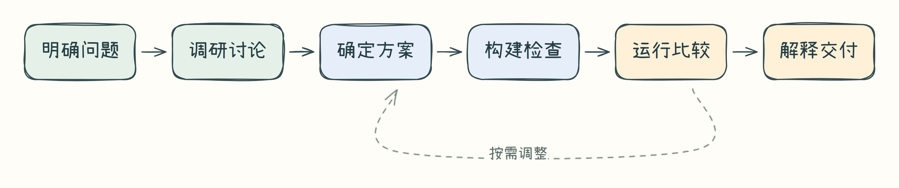

# zm_neuron_network

面向科学问题的神经元网络建模 Codex Skill。

从现象、现实需求、研究问题或指定模型出发，边调研边分轮讨论，明确科学问题、模型用途与必要机制；开放选择方法和软件，新建逐神经元网络优先采用适用的点模型，形态作用必需时采用多区室。依据文献、代码和数据构建或迭代，实际运行、比较与有限优化，逐题解释结果并保存方法、数据与图件。默认构建有基础发放率的静息态网络，也支持指定工程的扩展、检查与重分析，以及按需开展基础模型、负面影响与调控的衔接研究。

## 当前思考逻辑



研究深度由**科学问题、实际机制、数据约束和判别能力**决定。点模型可以承担正式研究；三维网络坐标不等于细胞形态。先明确必须实现和检验什么，再在满足要求的方案中优化计算成本。

调研与讨论贯穿全程：有实质发现且有待定取舍时，每轮集中讨论 2–3 问并给建议；必要设置确定后明确告知“本轮建模设置已确定，问题确认已完成”，继续已委托工作。默认构建有基础发放率的静息态网络，指定任务与状态优先。

需要研究不利条件后的改善时，按**基础模型 → 负面影响模块 → 调控模块**组织科学内容，三部分共用一套模型，仍沿用图中的六步工作流程。先查生物变化与机制，再选择有依据的作用和协议，通过匹配对照评价改善、保留功能和适用范围；详见[调控设计](references/regulation-design.md)。

一份当前方法串起来源、公式、参数、代码和实际输出。早期试运行、正式计算完成、实测支持及科学问题回答分别说明；最终按“摘要 → 模型与方法图 → 每题的结果图组和解释 → 一句话主要局限”交付。图为现行工作方式的概括，不代表已有科研结果。

[查看高清 SVG](assets/workflow/overview.svg) · [Excalidraw 可编辑文件](assets/workflow/overview.excalidraw) · [编辑说明](assets/workflow/README.md) · [模型选型细则](references/method-discovery.md#点模型优先与形态需求)

## 能做什么

- 研究过程中分轮讨论目标、观测与建模取舍，保存来源和当前研究状态。
- 比较多篇文献的方法，把来源数值、转换过程、本模型参数及实际对象对应起来。
- 按完整构建要素组织模型，优先选用适用点模型；形态作用必需时采用多区室，并将每项关键机制对应到实际观测与检查。
- 无特殊要求时构建具有基础发放率的静息态网络；完成实际运行、适用文献与真实数据比较及必要优化。
- 按网络组成组织代码，保留每个构建步骤的结果、原始数据、分析代码和科研图件。
- 作为 Academic Research Skills（ARS）科研流程的计算建模与实验环节：承接研究设计，详细调研并分轮讨论，向写作与审阅交回真实数据、图件和科学结论，再按反馈完成补充计算。也可独立使用，见[科研流程衔接](references/external-skills/academic-research.md)。
- 科研表达采用 anti-defensive-writing，模型代码可采用 Ponytail；每次调用检查接入项目的上游更新与规则冲突，记录实际采用版本。详见[技能分工](references/skill-integrations.md)和[检查规则](references/skill-update-review.md)。

完整工作方式见 [SKILL.md](SKILL.md)。本仓库不包含作者已构建的科研模型、实验数据、账号凭据或模拟器安装程序。

## 安装和更新

将本仓库克隆为 Codex 的一个技能目录。Windows PowerShell 示例：

```powershell
git clone https://github.com/zmneuron/zm_neuron_network.git "$env:USERPROFILE\.agents\skills\zm_neuron_network"
```

也可以下载仓库 ZIP，将其中整个技能目录放到 `~/.agents/skills/zm_neuron_network/`，或某个项目的 `.agents/skills/zm_neuron_network/`。该目录下应直接包含 `SKILL.md`，不要多套一层目录。技能未出现时重启 Codex。安装位置参照 [Codex 官方说明](https://learn.chatgpt.com/docs/build-skills)。本仓库公开可读，下载和获取更新无需协作者邀请。

通过 Git 安装后，可获取更新：

```powershell
git -C "$env:USERPROFILE\.agents\skills\zm_neuron_network" pull --ff-only
```

在 Codex 中调用，例如：

```text
$zm_neuron_network
我想研究某脑区静息活动中的一个现象。请先调研相关文献，与我讨论科学问题和模型取舍，再按确定范围构建并运行模型，保存方法、参数对应、逐步结果和数据图件。
```

需要完整科研流程时，可以说明：

```text
用 ARS 适配流程组织这项研究，将 $zm_neuron_network 作为计算建模与实验环节。先详细调研、分轮讨论问题和方法，再构建、运行与比较；根据实际结果撰写研究报告并复核，需要补充计算时返回模型环节。每次调用检查接入技能的版本和规则冲突。
```

## 运行环境

需要可使用本地技能的 Codex，以及实际任务所需的资料访问和计算环境。配套检查脚本使用 Python 标准库，建议 Python 3.11 或更高版本；真正的仿真、分析和绘图依赖按选定模型配置。技能不保证不同模型、数据或机器产生完全相同的研究结果。

## 目录与自检

| 目录 | 内容 |
|---|---|
| `references/` | 方法、要素、参数、机制、输出和比较规范 |
| `references/external-skills/` | anti-defensive-writing、Ponytail 核心文本及 MIT 许可；ARS 流程适配文本及 CC BY-NC 4.0 许可；固定来源版本 |
| `assets/` | 构建方法、机制说明、参数与结果模板 |
| `scripts/` | 项目与输出的检查工具 |
| `evals/` | 维护用合成软件测试、情境任务与检查记录 |
| `agents/` | 技能显示和调用信息 |

在仓库根目录可执行：

```text
python -B -X utf8 evals/test_check_model.py
python -B -X utf8 evals/test_check_elements.py
python -B -X utf8 evals/test_check_outputs.py
python -B -X utf8 evals/test_workflow.py
python -B -X utf8 evals/test_check_skill_sources.py
```

软件自检会在临时目录生成合成数据，不能代替真实科研模型的生物学验证。发布版省略依赖作者本地工程的少数评测案例，原编号保留，列表见 [publication.json](publication.json)。检查记录中的机器路径使用明确占位符；核心技能、模板与检查实现保留。

上游版本检查可单独运行 `python -B -X utf8 scripts/check_skill_sources.py`，只查询公开版本，不自动安装、覆盖或采用新技能。规则含义是否冲突仍须由助手阅读并记录，脚本不会自动宣称“无冲突”。ARS 接入是针对本领域的流程适配，未安装上游完整 Claude 插件及所有命令。ARS 原文与本仓库相应适配文本包含署名和非商业使用条件，详见[许可](references/external-skills/academic-research.LICENSE)；其他随附材料分别保留其原许可。

更新由维护者的本地发布工具在文件稳定且检查通过后推送。其他使用者通过 Git 更新或重新下载即可取得新版本。

仓库首段介绍和 About 简介随当前技能描述更新；[简介与标签配置](repository-about.json)随仓库版本保存。维护者在本地编辑说明后，发布工具会一并更新 README 和 GitHub About。
