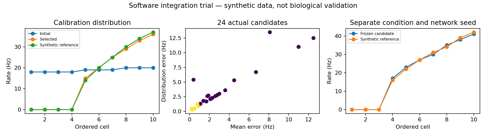

# 阶段性开源接入：实际试验与边界

2026-11-23。沿用原六步主线，局部适配研究方法，用真实库完成有限计算，再检查产物。候选维护位置、固定查阅提交、发布日期及许可见[来源记录](../references/open-source-candidates.json)，职责与冲突见[接入规则](../references/open-source-reuse.md)。大仓库自述、Star 和安装成功均不计为效果证明。

## 本次实际采用什么

| 层次 | 本次做了什么 | 不能据此声称什么 |
|---|---|---|
| 研究方法 | 阅读 Anthropic 问题选择、K-Dense 三个科研模块、Superpowers 完成复核与子 agent 实施正文及相关参考；把问题到比较的交接、独立反对意见和原要求回查纳入现有流程 | 未安装整套上游 Skill，未运行上游工具；方法的科学收益不能仅由适配文本证明 |
| 数值计算 | Brian2 2.10.1 执行十个点 LIF 细胞，Optuna 5.1.0 提议两参数/两目标候选，Matplotlib 3.8.4 从实际输出绘图；NumPy 2.1.3 | 非全部后端验证，非生物学重建；不说明该组合对所有任务最佳 |
| 记录与复核 | 原有运行记录保存配置、源码、版本与输出；新增 `reuse` 核对阶段、职责交接、版本与产物；独立复核原始脉冲、候选数据库并实际重绘 | 一致性检查不能证明源文献真实、问题重要或所有原要求均已登记 |

仅 Optuna 及缺少的 Alembic/Mako 安装在隔离环境，其余复用可用版本；没有改变科研模型。MLflow 与 LangGraph 未安装：本例已有记录和宿主分工足够；Docling、PaperQA、NEST/NEURON、BluePyOpt/eFEL 等仅完成定向资料核查，未来按实际缺口试用。

## 研究问题到设计的定向交接试用

给独立执行角色的范围是研究 CA1 静息活动中细胞发放差异与群体稳定性/可测活动的关系，模型未定、非临床干预、仅调研。角色实际读取本地适配，并核查 [Mizuseki 2013](https://pmc.ncbi.nlm.nih.gov/articles/PMC3804159/)、[Grosmark 2016](https://buzsakilab.com/content/PDFs/Grosmark2016.pdf)、[Valero 2015](https://pmc.ncbi.nlm.nih.gov/articles/PMC4820637/) 等相关原始研究；没有读既有科研模型或进行仿真。形成 Q1 的平均率/异质性/协方差比较和 Q2 的相容机制与额外被动观测比较，直接交到现有方法文档，没有虚构用户选择或已运行结果。

未负责该试用实现的接收角色先读原委托与产物，再查来源，认为足以进入下一阶段方法设计，仍不足以直接启动正式机制判别。它指出两个实质边界：记录单元的窗口零计数不是整个 CA1 的真实沉默比例；Q2 目前只有候选读数，尚需证明不同机制在可比约束下确有可测分歧。前者补入[校准规则](../references/calibration.md)，后者作为设计/小比较的必需检查保留。具体静息状态、稳定性含义、方程与参数、数据用途划分和预算仍待确定。

执行约 8 分钟，接收复核约 2 分钟；原始数据未下载，部分论文方法访问受限，已如实记录。该试用验证了**一次局部方法应用与职责交接**，没有比较同预算的有/无适配效果，也未测试无限自由交流或证明选题创新。它不是完整模型研究成功的替代。

## 真实执行的合成小网络试验

模型有 8 个兴奋性、2 个抑制性点 LIF 细胞，稀疏随机循环连接和指数衰减的有效突触驱动。采用

\[
\frac{dv_i}{dt}=\frac{-65\,\mathrm{mV}-v_i+D_i+s_i}{20\,\mathrm{ms}},\qquad
\frac{ds_i}{dt}=-\frac{s_i}{5\,\mathrm{ms}},\qquad
D_i=\mu+\Delta+\sigma z_i.
\]

`z_i` 为 [-1,1] 上十个均匀分位，阈值 −50 mV、复位/初态 −65 mV、不应期 2 ms、初始突触驱动为零；突触事件延迟 0.4 ms 后增加有效电压驱动（兴奋 +0.08 mV、抑制 −0.12 mV），不冒称真实电导。连接概率 0.3，无自连接。NumPy 后端、Euler 步长 0.2 ms，运行 1.2 s，分析末 1 s。公式与触发/复位直接在[测试代码](open_source_trial.py)实现；范围、输入及标准均为软件测试设置，不是生理界限。

Optuna TPE 联合搜索背景驱动均值 μ∈[14.5,19] mV 与离散幅度 σ∈[0,7] mV；目标分别为平均率绝对误差和有序逐细胞率平均绝对差。逐项接受另要求平均率差≤1 Hz、零发放比例差≤0.1、90% 分位率差≤3 Hz。评价条件在选定候选后使用新的连接种子及 +1.5 mV 输入偏移；不将该评价再次用于选参。

24 个候选分两个独立进程、每批 12 个运行；SQLite 保存 trial，另保存本地采样器状态及校验值，未重复先前 trial。5 个同时满足三项条件，选中 trial 9（μ=16.0241 mV，σ=4.7348 mV）。总计 **28 次完成计算**：两份合成参考、初始、24 候选和一次冻结后评价。另有一次先前导出失败保留原目录，因此此次数值开发实际调用 **29 次**；不能只报成功数。

| 比较对象 | 平均发放率 / Hz | 零发放比例 | 90% 分位率 / Hz |
|---|---:|---:|---:|
| 初始模型 | 18.9 | 0 | 20.0 |
| 校准条件合成参考 | 16.0 | 0.4 | 34.3 |
| 选中候选 | 15.8 | 0.4 | 33.3 |
| 独立条件合成参考 | 21.1 | 0.3 | 39.3 |
| 冻结候选的独立条件输出 | 21.1 | 0.3 | 38.3 |



中图黄色为同时满足全部分项条件的候选，紫色为未全部满足者；颜色不是优化器自己的科学判断。图和数字来自实际输出，独立复核从原始 spikes 重算 rates、均值/静默/q90，并核对数据库 trial、实际配置和目标；重绘 PNG 与原图一致。这个试验验证了求解、搜索、记录和接受逻辑的衔接，**参考仍是合成数据，不能证明真实生物校准、机制正确或 Optuna 优于其他算法**。

## 发现的问题与修复检查

- 首次数值运行在导出连接时，把 Brian2 的公共标量延迟误当数组；修复为按实际连接广播，失败原记录仍为当时的 `partial/started`，后续另记原因，未改写成成功。
- 独立审查复现：普通文档可冒充软件输出、`reuse` 没有具体项目仍通过、丢失 sampler 文件后静默重建随机状态。已分别要求输出属于实际完成运行且证据包含运行记录、采用项目与阶段对应、数据库和采样器记录完整对应；原失败输入现被拒绝，正常路径仍可使用。
- 开始时登记过复用检查的项目，不能删掉 `reuse` 后假装旧工程以跳过检查。旧工程确实没有该记录时仍显示未复核，不篡改历史。
- 继续调参/重复冻结被拒绝；重绘未增加仿真预算。完整连续运行与分批运行的候选序列是否完全相同，本次未比较，不由“种子相同”推断。

这些记录层回归用例已并入 `test_workflow.py`，不要求安装可选数值依赖；它们检查真实失败条件，未用关键词或六个标题代替行为验证。独立复核修复时未再仿真；数值核心未变，修复后的恢复保护单独检查。

## 复现实验

在适用 Python 环境中按[可选依赖](open-source-requirements.txt)安装到隔离环境，再从技能根目录执行；不要使用已有科研工程目录。示例新建目录，拒绝覆盖已有初始结果。

```text
python -B -X utf8 evals/open_source_trial.py --workspace NEW_DIRECTORY --init
python -B -X utf8 evals/open_source_trial.py --workspace NEW_DIRECTORY --trials 12
python -B -X utf8 evals/open_source_trial.py --workspace NEW_DIRECTORY --trials 12
python -B -X utf8 evals/open_source_trial.py --workspace NEW_DIRECTORY --finalize
python -B -X utf8 evals/open_source_trial.py --workspace NEW_DIRECTORY --replot
```

一个目录仅允许一个调度者；数据库之外的采样器文件只能载入本例自己生成、未被改动且环境一致的可信本地文件。异常中断后的候选需先诊断，不支持任意崩溃点自动恢复。当前测试脚本是小型接入示例，不是通用生产优化框架；正式网络仍按组件组织代码并采用本项目完整记录。

真实生物数据效用、跨平台稳定性和等预算优化器优劣尚未验证；按具体任务需要再评估，不将所有候选变成必装功能。
